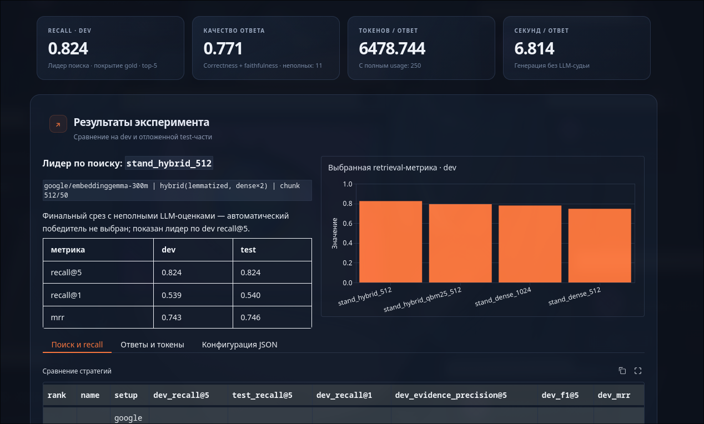

1. **Репозиторий исходного кода** — [tainj/rag-quality-lab](https://github.com/tainj/rag-quality-lab).

# RAG Lab — пояснительная записка

## 1. Цель и задача

Команде, которая внедряет помощника по базе знаний, нужно решить, как разбивать документы, каким поиском пользоваться и какой промпт давать агенту. RAG Lab сравнивает настройки на одних и тех же вопросах. Пользователь видит, нашлись ли подтверждающие фрагменты, насколько ответ соответствует эталону и сколько токенов потребовалось агенту.

## 2. Технологии и версии

| Компонент | Применение |
|---|---|
| Python ≥ 3.12, uv 0.13.4 в Dockerfile | Среда исполнения и установка по uv.lock |
| Gradio 6.29.1, Typer 0.27.0 | Веб-интерфейс и CLI |
| HTTPX 0.28.1, OpenAI Python SDK 2.49.0 | Запросы к agent-core и модели |
| pandas 3.0.5 | Загрузка таблиц и агрегация результатов |
| DeepEval 4.1.4 | Оценка ответов моделью-судьёй |
| Ruff 0.16.0, unittest из Python | Статические проверки и тесты |

Версии Python-пакетов взяты из uv.lock. Внешняя платформа agent-core предоставляет агента, поиск и коллекции. Модели по умолчанию — intfloat/multilingual-e5-base для эмбеддингов и gpt-4o-mini для генерации. Укажите идентификаторы поддерживаемых вашим стендом моделей через LLM_MODEL и AGENT_MODEL в .env. Промпты также можно переопределить в .env по именам из configs/settings.json. Для многострочных шаблонов используйте JSON. Модель поиска, размер вектора и префиксы задаются вместе в EVAL_COLLECTION_EMBEDDING в JSON. Версии серверных компонентов определяет оператор стенда.

## 3. Архитектурный подход

GUI и CLI вызывают общий поэтапный конвейер. Он обращается к agent-core через HTTP-клиент и записывает состояние эксперимента на диск. Поиск выполняется в двух сценариях: прямым запросом для оценки выдачи и через инструмент агента для получения ответа. Запрос, который сформулировал агент, может отличаться от исходного вопроса.

## 4. Допущения и ограничения

Для реального прогона требуется доступный agent-core с правами на работу с коллекциями, документами, агентами и моделью. Пользователь сам предоставляет разрешённый к обработке корпус. Для корпуса JSONL нужны поля `doc_id` и `text` с уникальными идентификаторами. Также поддерживаются CSV и загрузчик статей BPMSoft. Содержимое документов передаётся настроенному стенду. Корпуса компаний, ключи, готовые индексы, истории диалогов и рабочие результаты в поставку не входят.

Синтетические эталоны требуют выборочной проверки человеком. Совпадение цитаты с документом подтверждает источник, но само по себе не гарантирует правильности эталона. Отсутствующие оценки и отсутствующий usage ограничивают сравнимость результатов.

## 5. Алгоритмические решения

1. **Подготовка и синтетика.** Загрузчик очищает HTML и приводит документы к тексту. Генератор выбирает фрагменты, запрашивает вопрос, эталон и цитаты, проверяет их в источнике и сохраняет символьные границы свидетельств. Для multi-hop выбираются соседние фрагменты одного документа. Дубликаты и неподтверждённые цитаты отбраковываются.
2. **Индексация.** Для пресета формируется конфигурация коллекции, документы загружаются на стенд. Конвейер отслеживает задания индексации и переиспользует готовую совместимую коллекцию при совпадении корпуса. Поставляются dense 512, dense 1024, hybrid 512 с лемматизацией и hybrid 512 с Qdrant BM25. Во всех четырёх пресетах реранкер выключен.
3. **Поиск.** Для размеченных вопросов конвейер запрашивает top-k и сопоставляет найденные участки со свидетельствами. Recall оценивает покрытие эталонных интервалов, evidence precision — долю подтверждающего текста в найденном контексте. Пересечения интервалов в одном документе объединяются.
4. **Ответы и оценка.** Агент вызывает поисковый инструмент коллекции. Сохраняются ответ, найденные фрагменты, время и доступный usage. Судья оценивает соответствие эталону и подтверждённость ответа контекстом. Для вопросов без ответа используется проверка отказа.
5. **Сравнение.** Разбиение dev/test детерминировано идентификатором вопроса. На dev отбираются кандидаты по поиску и сравниваются по качеству ответов, test даёт отдельный срез. Контрольные точки позволяют повторять неуспешные операции и досчитывать оценки по сохранённым ответам.

## 6. Модули и состав поставки

| Путь | Содержимое |
|---|---|
| configs/, config.py | JSON-настройки и пресеты, проверка типов и загрузка окружения |
| evalkit/gui.py, evalkit/cli.py | Точки входа интерфейса и командной строки |
| evalkit/pipeline.py, evalkit/rag_config.py | Этапы эксперимента, идентичность конфигураций, состояние и выбор результата |
| evalkit/synthetic.py, evalkit/dataset_loaders.py, evalkit/csv_loader.py, evalkit/data_catalog.py | Генерация вопросов, подготовка корпуса и каталог наборов |
| evalkit/api_client.py, evalkit/client.py, evalkit/transport.py, evalkit/llm_http.py | Доступ к платформе и модели |
| Остальные модули evalkit/ | Сопоставление интервалов, метрики поиска и ответов, учёт токенов, вспомогательные процедуры оценки |
| scripts/ | Сценарий сравнения и восстановление состояния индексации |
| notebooks/ | Пять исследовательских ноутбуков и вспомогательный Python-модуль |
| tests/ | Проверки на тестовых примерах и имитациях ответов сервисов |
| docs/results/, docs/assets/, docs/demo/ | Агрегированные результаты контрольного прогона, снимок дашборда и короткая демонстрация интерфейса |
| Корень | Dockerfile, Compose, зависимости, файл фиксации версий, пример окружения и правила исключения локальных файлов |

## 7. Сборка

В каталоге исходников с установленными Python и uv выполните:

```bash
uv sync --frozen
uv run python -m unittest discover -s tests -q
```

Для контейнерного варианта образ собирается командой `docker compose build gui`. Dockerfile устанавливает зависимости из lock-файла в отдельном слое.

## 8. Развёртывание

Скопируйте `.env.example` в `.env`, укажите URL доступного agent-core и свой токен. При `LLM_VIA_PLATFORM=1` вызовы модели идут через этот же стенд. Для контейнера адрес должен быть доступен из его сети. Создайте локальные каталоги и предоставьте пользователю контейнера права записи в data и runs (по умолчанию UID 1000).

```bash
mkdir -p configs data data_bpmsoft dataset runs
docker compose up -d gui
```

Настройки и исходные каталоги подключаются томами. Прогресс сохраняется в runs между перезапусками. Для размещения на общем сервере ограничьте доступ к порту GUI средствами сети организации.

## 9. Запуск

Для локального GUI выполните `uv run python -m evalkit.cli gui`, затем откройте [localhost:7860](http://localhost:7860). При использовании Compose GUI запускается на предыдущем шаге.

Пример последовательности CLI с собственным документным корпусом:

```bash
uv run python -m evalkit.cli configs
uv run python -m evalkit.cli synthesize --corpus /path/to/corpus.jsonl --size 20 --name trial-qa
uv run python scripts/run_comparison.py --dataset trial-qa --full --one-prompt --retry-errors --run-id trial-full
uv run python -m evalkit.cli show trial-full
```

Чтобы продолжить этот же эксперимент, повторите команду run_comparison.py с теми же аргументами и добавьте `--resume`.

## 10. Руководство пользователя

| Раздел GUI | Действия |
|---|---|
| Синтетика | Загрузите корпус, выберите типы и количество вопросов. Проверьте предпросмотр и нажмите «Использовать в эксперименте». |
| Подбор | Выберите набор и пресеты. При необходимости измените промпт и описание инструмента. Для оценки всех четырёх пресетов поставьте 4 в поле лучших стратегий и включите «Все вопросы для ответов · dev + test». Затем запустите эксперимент. |
| Журнал | Выберите запуск из истории. Следите за этапом и ошибками. Готовность оценки проверяйте по сохранённым метрикам: попытка может завершиться ошибкой. |
| Результаты | Сравните поиск, качество ответов, охват оценок, расход токенов и время. Выбранную конфигурацию можно скачать как JSON. |
| Чат | Выберите конфигурацию и задайте вопрос. Сопоставьте ответ с найденными источниками. |
| Выкладка | Выберите конфигурацию и целевые параметры, проверьте их перед подтверждением создания агента на стенде. |

Контрольный прогон выполнен на 883 документах и 250 вопросах для четырёх
конфигураций без реранкера. Лучший результат поиска показал
`stand_hybrid_512`: dev recall@5 — 0,824, test recall@5 — 0,824,
faithfulness — 0,949, итоговая оценка генерации — 0,771. Среднее время ответа
составило 6,81 секунды, средний расход — 6479 токенов. У 11 из 250 ответов
этой конфигурации отсутствует часть обязательных LLM-оценок из-за достижения
лимита длины ответа модели-судьи; пропуски не заменялись нулями.

[Сводка результатов](docs/results/README.md) ·
[полные агрегированные таблицы](docs/results/) ·
[снимок дашборда](docs/assets/results-dashboard.png) ·
[демонстрация интерфейса, 1:54](docs/demo/RAG-Lab-demo.mp4)



## 11. ToDo

- Показывать раздельные счётчики попыток, полученных ответов и полностью оценённых вопросов.
- При серии HTTP 500 проверять реальный вызов модели и возобновлять очередь после восстановления стенда.
- Добавить пресеты hybrid 1024 для сравнения обоих способов гибридного поиска при двух размерах фрагмента.
- Добавить ручную проверку эталонов в интерфейсе и экспорт списка спорных вопросов.
